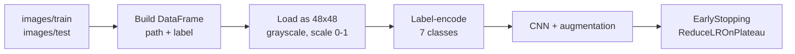

<h1 align="center">😊 Face Emotion Detection</h1>

<p align="center">Face emotions detection of a person using deep learning: a CNN that classifies a 48x48 grayscale face image into one of seven emotions.</p>

<p align="center">
  
  
  
  
</p>

<p align="center">
  <a href="#-pipeline"><b>Pipeline</b></a> ·
  <a href="#-model">Model</a> ·
  <a href="#-dataset-layout">Dataset</a> ·
  <a href="#-quick-start">Quick start</a> ·
  <a href="#-files">Files</a>
</p>

---

## 🔎 Pipeline



## 🧠 Model

| Part | Detail |
|---|---|
| Input | 48 x 48 x 1 grayscale image |
| Convolution blocks | Conv 64, Conv 128, Conv 256 (3x3, ReLU, L2 regularization), each with BatchNormalization, MaxPooling and Dropout 0.25 |
| Classifier | Flatten, Dense 512 with BatchNormalization and Dropout 0.5, then Dense 7 (softmax) |
| Augmentation | Rotation 15, width and height shift 0.1, shear 0.1, zoom 0.1, horizontal flip |
| Optimizer | RMSprop (learning rate 0.001), categorical cross-entropy |
| Training control | Up to 50 epochs, batch size 128, early stopping (patience 5) and learning-rate reduction on plateau |

## 🗂️ Dataset layout

One sub-folder per emotion, with the folder name as the label:

```text
images/
  train/
    angry/  happy/  sad/  ...
  test/
    angry/  happy/  sad/  ...
```

The script turns this into a table of image path and label, which is then encoded to 7 classes.

## 🚀 Quick start

```bash
pip install tensorflow keras pandas numpy scikit-learn tqdm opencv-contrib-python
python Face_Emotion_Detection.py
```

Libraries used (see `Requirement.txt`): TensorFlow and Keras (model), pandas (image/label table), NumPy (arrays), tqdm (progress bars) and OpenCV contrib (computer vision utilities).

## 📁 Files

| File | Purpose |
|---|---|
| `Face_Emotion_Detection.py` | Data loading, CNN definition and training |
| `my_model.keras` | Trained model |
| `Requirement.txt` | Libraries and the dataset table layout |
| `Project Report.docx` | Project report |
